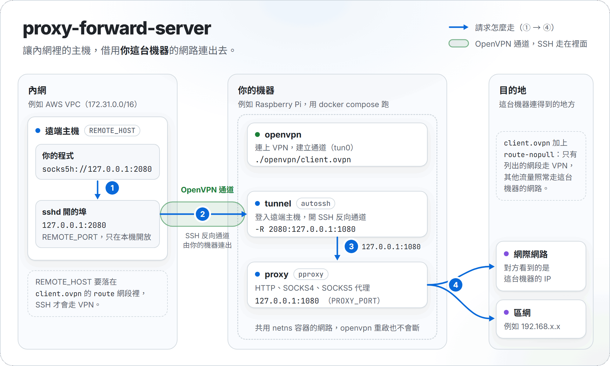

# Proxy Forward Server

<p align="center">
  <a href="https://github.com/NatLee/proxy-forward-server/actions/workflows/test.yml"></a>
</p>

讓內網裡的一台主機（例如 AWS VPC 裡的 EC2），借用你手上另一台機器（例如家裡或辦公室的 Raspberry Pi）的網路連出去。

你的機器先用 OpenVPN 連進內網，再用 SSH 反向通道把遠端主機的 `127.0.0.1:2080` 接回自己身上的代理伺服器 [pproxy](https://github.com/qwj/python-proxy)。遠端主機上的程式只要把代理設成 `127.0.0.1:2080`，流量就會從你的機器出去。所有元件都跑在 Docker 裡，一行 `docker compose up` 就能啟動。

> [!IMPORTANT]
> **升級注意（2026-11）**：代理現在預設只聽 `127.0.0.1`，只有 SSH 通道用得到。如果你原本透過 VPN 直接連代理（例如 `10.8.0.2:1080`），在 `.env` 加一行 `PROXY_BIND=0.0.0.0` 就會恢復舊的行為。
>
> 這一版也多了一個 `netns` 容器，`openvpn` 改用 repo 裡的映像檔，所以更新後要重新 build 一次：`docker compose up -d --build`。遠端主機也不再需要空出 `20000` 埠。

## 什麼時候用得到

- 內網的主機不能直接上網，例如在沒有 NAT 的私有子網裡，但需要下載套件或呼叫外部 API。
- 想讓請求從你的機器的 IP 出去，例如對方只允許辦公室的 IP 連線。
- 遠端主機需要連到你的機器所在的區網，例如 `192.168.x.x` 上的服務。

你的機器不用開任何對外的埠：VPN 和 SSH 連線都是它主動連出去的。

## 運作方式

<p align="center">
  <picture>
    <source media="(prefers-color-scheme: dark)" srcset="docs/images/flow-dark.png">
    
  </picture>
</p>

一個請求會經過這四步：

1. 遠端主機上的程式連到 `127.0.0.1:2080`（`REMOTE_PORT`）。這個埠是遠端的 SSH 伺服器為反向通道開的，只在遠端主機本機開放。
2. SSH 伺服器把連線送進 SSH 反向通道。這條 SSH 連線是你的機器上的 `tunnel` 容器（autossh，斷線會自動重連的 SSH）主動建立的，而且走在 OpenVPN 通道裡。
3. 連線回到你的機器，交給 `proxy` 容器裡的 pproxy（`127.0.0.1:1080`，`PROXY_PORT`）。
4. pproxy 用你的機器原本的網路連到目的地，所以對方看到的是你的機器的 IP。

`openvpn`、`tunnel`、`proxy` 三個容器共用同一個網路，這個網路由一個什麼都不做的 `netns` 容器持有（`network_mode: service:netns`）。所以：

- `tunnel` 的 SSH 連線會照 VPN 的路由進到內網。
- `tunnel` 用 `127.0.0.1` 就找得到 `proxy`，代理不用對其他人開放。
- `openvpn` 重啟或當掉時，這個網路還在，`tunnel` 和 `proxy` 不用跟著重啟，連線會自己恢復。

## 需要準備的東西

**你的機器**（跑這個專案的那台）

- Linux，例如 Raspberry Pi OS 或 Ubuntu，裝好 Docker 和 Docker Compose v2（`docker compose version` 要能跑）。
- `/dev/net/tun`，OpenVPN 要用，一般的 Linux 都有。
- 能上網：第一次 build 要下載映像檔和套件。之後啟動時不會再安裝任何東西。
- 一份 OpenVPN 客戶端設定檔（`.ovpn`）。連上 VPN 之後，要能連到遠端主機。

**遠端主機**（要借網路出去的那台）

- 開著 SSH 伺服器，而且允許連接埠轉發（`AllowTcpForwarding yes`，Ubuntu 和 Debian 預設就是）。
- 一個可以用金鑰登入的帳號，範例是 `ubuntu`。
- 本機的 `2080` 埠沒被佔用，這是給程式用的代理埠（`REMOTE_PORT`）。

## 安裝與啟動

### 1. 下載專案

```bash
git clone https://github.com/NatLee/proxy-forward-server.git
cd proxy-forward-server
```

### 2. 產生 SSH 金鑰，把公鑰放到遠端主機

金鑰不要設密碼，因為 autossh 要能自己登入：

```bash
mkdir -p keys
ssh-keygen -t ed25519 -f ./keys/key-to-aws.pem -N ""
cat ./keys/key-to-aws.pem.pub
```

把印出來的那一行，加到遠端主機上該帳號的 `~/.ssh/authorized_keys` 最後面。

### 3. 放好 OpenVPN 設定檔，加上路由設定

```bash
mkdir -p openvpn
cp /path/to/your.ovpn openvpn/client.ovpn
```

接著在 `openvpn/client.ovpn` 裡加上這幾行，網段依你的環境調整：

```nginx
# 不套用 VPN 伺服器推過來的路由
route-nopull

# VPN 本身的網段
route 10.8.0.0 255.255.255.0 vpn_gateway

# 遠端主機所在的網段，REMOTE_HOST 一定要在這裡面
route 172.31.0.0 255.255.0.0 vpn_gateway
```

為什麼要這樣設：

- **`route-nopull`**：有些 VPN 伺服器會要求「所有流量都走 VPN」。如果照做，代理出去的流量就會改從 VPN 那一端出去，甚至完全連不出去，失去借用你的機器網路的意義。加上這行之後，只有下面列出的網段走 VPN，其他流量照常走你的機器原本的網路。
- **兩行 `route`**：把需要的網段加回 VPN。`REMOTE_HOST` 不在這些網段裡的話，SSH 會走你的機器原本的網路，連不到內網的遠端主機。
- 如果你的 `.ovpn` 會執行外部腳本（`up`、`down` 之類），還要加上 `script-security 2`。

### 4. 設定 `.env`

```bash
cp .env.example .env
```

打開 `.env`，至少改掉 `REMOTE_HOST` 和 `REMOTE_USER`。每個欄位的意思見下面的[設定參考](#設定參考)。

### 5. 啟動

```bash
docker compose up -d --build
```

## 確認能用

在你的機器上，先看四個容器都在跑（`netns`、`openvpn`、`tunnel`、`proxy`），VPN 也連上了：

```bash
docker compose ps
docker compose logs openvpn | grep "Initialization Sequence Completed"
docker compose logs tunnel
```

`tunnel` 會一直重試，直到 VPN 連上、登入遠端主機為止。剛啟動時日誌出現幾次連線失敗是正常的；連上之後，除了第一次連線時的 `Permanently added '…' to the list of known hosts`，不應該一直出現錯誤。

接著到遠端主機上，確認代理埠開了，再實際走一次代理：

```bash
ss -tln | grep 2080      # 應該看到 127.0.0.1:2080

curl -x socks5h://127.0.0.1:2080 https://api.ipify.org   # SOCKS5，印出你的機器的對外 IP
curl -x http://127.0.0.1:2080 https://api.ipify.org      # HTTP 代理，結果應該一樣
```

想讓遠端主機上大部分的程式都走代理，可以設環境變數：

```bash
export http_proxy=http://127.0.0.1:2080
export https_proxy=http://127.0.0.1:2080
```

代理支援這幾種協定，都在同一個埠上：

- **HTTP**，包括 HTTPS 網站（用 `CONNECT`）。
- **SOCKS5**。建議用 `socks5h://`，讓網址也交給你的機器去查，這樣只有你的區網查得到的名稱也能用。
- **SOCKS4**，只能給 IP。不支援 SOCKS4a，也就是不能直接給網址。

## 設定參考

`.env` 裡前六個欄位都要有值，`docker-compose.yml` 沒有預設值。少了的話，Compose 會警告 `The "…" variable is not set`。`PROXY_BIND` 可以不填，預設是 `127.0.0.1`。

| 欄位 | 範例值 | 用途 |
|---|---|---|
| `REMOTE_HOST` | `172.31.67.145` | 遠端主機的 IP。要在 `.ovpn` 的 `route` 網段裡 |
| `REMOTE_USER` | `ubuntu` | 遠端主機上的 SSH 帳號 |
| `REMOTE_PORT` | `2080` | 遠端主機上給程式用的代理埠，只在遠端本機開放 |
| `SSH_KEY_PATH` | `./keys/key-to-aws.pem` | SSH 私鑰，相對於 `docker-compose.yml` |
| `OVPN_CONFIG_PATH` | `./openvpn/client.ovpn` | OpenVPN 設定檔 |
| `PROXY_PORT` | `1080` | pproxy 在你的機器上（容器裡）聽的埠 |
| `PROXY_BIND` | `127.0.0.1` | pproxy 聽的位址。預設只有 SSH 通道用得到；`0.0.0.0` 是舊版的行為，VPN 和 Docker 網路上的主機也能直接用。要包含 `127.0.0.1`，SSH 通道才連得到 |

這些是寫死在 `docker-compose.yml` 裡的設定：

- 容器名稱：`pi-netns`、`pi-openvpn-client`、`pi-tunnel-worker`、`pi-pproxy`。
- 共用網路用的 DNS：`8.8.8.8`、`1.1.1.1`（設在 `netns`）。
- 斷線偵測：SSH 每 10 秒確認一次遠端還在，30 秒沒回應就斷開重連（`ServerAliveInterval 10`、`ServerAliveCountMax 3`）。autossh 不另外占用監控埠（`-M 0`）。
- 重試：連不上時 autossh 會一直重試，連第一次也一樣（`AUTOSSH_GATETIME=0`）。每次連線最多等 10 秒（`ConnectTimeout 10`），兩次重試最多隔 30 秒（`AUTOSSH_POLL=30`）。
- 所有服務都設了 `restart: always`，開機或當掉之後 Docker 會自動重啟。
- 固定的版本：Alpine 3.24.3（OpenVPN、autossh 都從這版安裝）、Python 3.12.16、pproxy 2.7.9。Dependabot 每週檢查有沒有新版，有的話會開 PR。

## 疑難排解

**`docker compose up` 顯示 `bind source path does not exist`**

`.env` 裡的 `OVPN_CONFIG_PATH` 或 `SSH_KEY_PATH` 指到不存在的檔案。檢查路徑，把檔案放好再啟動。Windows 上的 Docker Desktop 不會報這個錯，而是在那個路徑建一個空資料夾，接著就會遇到下一項。

**`openvpn` 日誌出現 `No tls-client or tls-server option`，`openvpn/client.ovpn` 變成資料夾**

啟動時檔案不存在，Docker 自動建了一個同名的空資料夾。刪掉這個資料夾，放好 `.ovpn` 再啟動。

**`openvpn` 日誌出現 `can't ask for 'Enter Auth Username:'`**

你的 VPN 要帳號密碼（`.ovpn` 裡有 `auth-user-pass`），但容器裡沒辦法輸入。目前的 `docker-compose.yml` 只掛載 `.ovpn` 一個檔案。要用這種 VPN，得自己多掛載一個帳密檔，並讓 `auth-user-pass` 指向它（這個做法本專案沒有實測）。

**`tunnel` 日誌出現 `remote port forwarding failed for listen port 2080`**

遠端主機的 SSH 伺服器不允許轉發，或那個埠已經被佔用。檢查遠端的 `/etc/ssh/sshd_config` 裡的 `AllowTcpForwarding`，或換一個 `REMOTE_PORT`。`tunnel` 會自己重啟再試。

**`tunnel` 日誌出現 `Network unreachable` 或 `Connection refused`**

VPN 還沒連上或斷線了，或 `REMOTE_HOST` 不在 `.ovpn` 的 `route` 網段裡。先看 `docker compose logs openvpn`，再檢查 `route` 那幾行。

**`tunnel` 日誌出現 `Permission denied (publickey…)`**

遠端主機不認得這把金鑰。確認公鑰加進了 `REMOTE_USER` 這個帳號的 `~/.ssh/authorized_keys`。

**`openvpn` 重啟或 VPN 斷線之後，代理多久會恢復**

不用做任何事，會自己恢復。實測的時間：

- `docker restart` openvpn，或容器當掉後被 Docker 重啟：大約 1 秒。這種短暫中斷，SSH 連線不會斷。
- VPN 斷了 45 秒：VPN 恢復後 30 秒內，因為 autossh 最多隔 30 秒就重試一次（實測 2 到 12 秒）。這時 SSH 已經放棄舊連線，會重新登入一次。
- 重啟 Docker 本身（跟重開機一樣，所有容器一起重啟）：大約 10 秒。

VPN 剛恢復時，`tunnel` 日誌如果出現 `remote port forwarding failed for listen port 2080`，代表遠端主機的 SSH 伺服器還沒放掉舊連線。autossh 會繼續重試，等舊連線放掉就會接上。

`openvpn` 日誌出現 `removing leftover network interface tun0` 也是正常的。OpenVPN 用核心加速（DCO）時，如果上一次被強制結束，`tun0` 會留下來；啟動前會先把它清掉。

**透過 VPN 直接連代理（例如 `10.8.0.2:1080`）連不上了**

代理現在預設只聽 `127.0.0.1`。在 `.env` 加上 `PROXY_BIND=0.0.0.0`，再執行 `docker compose up -d`。

改了 `.env` 之後，請用 `docker compose up -d` 套用到整個專案，不要只寫 `docker compose up -d proxy`。只指定一個服務時，Compose 可能會重建 `netns`，卻沒有一起重建 `openvpn` 和 `tunnel`，它們就會卡在舊的網路裡（測試裡遇過）。

**代理連得上，但網站打不開**

`.ovpn` 可能少了 `route-nopull`，對外流量被 VPN 接走了。照[第 3 步](#3-放好-openvpn-設定檔加上路由設定)加上路由設定。

想看每個經過代理的連線，可以用 `docker compose logs -f proxy`。

## 安全注意事項

- **代理沒有帳號密碼，預設只聽 `127.0.0.1`。** 只有走 SSH 通道進來的連線用得到。如果設成 `PROXY_BIND=0.0.0.0`，同一個 VPN 裡連得到你的機器的主機，以及同一個 Docker 網路上的容器，都能直接使用這個代理，測試裡確認過。
- **遠端的 `2080` 只給遠端主機自己用。** SSH 伺服器預設只在本機開這個埠（`GatewayPorts no`），內網的其他主機連不到。除非你清楚會有誰連進來，不要打開 `GatewayPorts`。
- **第一次連線不檢查遠端主機的身分。** `tunnel` 用了 `StrictHostKeyChecking no`。平常連線走在 VPN 裡，風險比較低。但 VPN 斷線時，連到 `REMOTE_HOST` 的封包會改走你的機器原本的網路（測試裡看得到），所以仍然要知道有這件事。
- **金鑰和 VPN 設定不要進 git。** SSH 私鑰沒有密碼保護。`.env`、`keys/`、`openvpn/` 已經寫在 `.gitignore` 裡。建議在遠端主機開一個專用的帳號給這把金鑰。

## 測試

不需要真的 VPN 或伺服器，也能把整條路跑一遍：

```bash
sh tests/e2e/run.sh
```

這個測試會用 Docker 架一台臨時的 OpenVPN 伺服器，它同時也是 SSH 主機，而且只能從 VPN 連到。接著把真的 `docker-compose.yml` 指過去，然後確認：

- 那台主機透過 `127.0.0.1:2080` 連得到 `https://example.com`，SSH 確實走 VPN。
- 代理預設只給 SSH 通道用，VPN 和 Docker 網路上的其他主機連不到；設了 `PROXY_BIND=0.0.0.0` 才連得到。
- `openvpn` 被重啟、被強制結束、斷線 45 秒之後，代理都會在限定時間內自己恢復。
- `openvpn` 映像檔裡已經有 OpenVPN，啟動時沒有安裝任何套件。

整個過程大約兩分半鐘，跑完會刪掉所有容器和臨時產生的憑證，不會讀取或修改你的 `.env`、`keys/`、`openvpn/`。

GitHub Actions 在每次 push 和 PR 都會跑這個測試，另外還會重啟 Docker 本身，確認像重開機那樣全部重啟之後也會恢復。

## 專案結構

```text
.
├── docker-compose.yml   四個服務：netns、openvpn、tunnel、proxy
├── .env.example         設定範例，複製成 .env 再改
├── vpn/Dockerfile       OpenVPN 映像檔（netns 也用它）
├── proxy/               pproxy 映像檔，版本在 requirements.txt
├── tunnel/Dockerfile    autossh 映像檔
├── .github/             CI 和 Dependabot 設定
├── tests/e2e/           不需要真的 VPN 的端到端測試
├── docs/images/         README 的流程圖，原始 HTML 在 src/
├── keys/                放 SSH 金鑰，不進 git
└── openvpn/             放 .ovpn，不進 git
```
